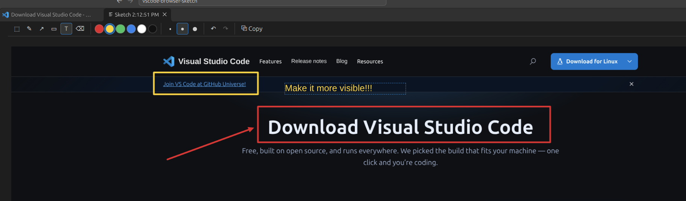
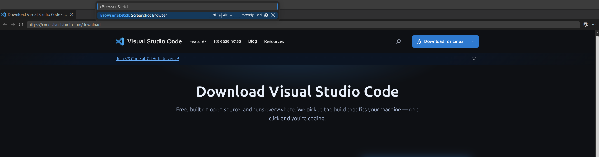

# Browser Sketch

Screenshot the **VS Code Integrated Browser** with one shortcut, draw on it and copy it to the clipboard. Show an AI agent or a teammate what to fix on a page, without leaving the editor.

## Usage

1. Open a page in the VS Code Integrated Browser.
2. Press **`Ctrl+Alt+S`** (or click the camera icon in the status bar, or run "Browser Sketch: Screenshot Browser" from the Command Palette).
3. The screenshot opens in a new "Sketch" tab — mark what needs fixing.
4. **`Ctrl+C`** copies the image with your drawing to the clipboard. Paste it into a chat, an issue or a messenger.

The screenshot shows what is visible in the tab, in its current state. The page is not reloaded, so logins, open dialogs and scroll position stay as they are. WebGL and canvas content is captured.

## Tools

| Tool | Key | What it does |
| --- | --- | --- |
| Select | `S` | Drag an area to copy. `Esc` clears the selection. |
| Pen | `P` | Freehand drawing. |
| Arrow | `A` | Default tool. |
| Rectangle | `R` | Frame around an element. |
| Text | `T` | Click, type, confirm with `Enter`. |
| Eraser | `E` | Click or drag over an object — it is removed as a whole. |

- Six colors (red by default) and three stroke widths in the toolbar.
- **`Ctrl+Z`** undoes, **`Ctrl+Shift+Z`** redoes.
- **`Ctrl+C`** or **`Enter`** copies the selected area; without a selection, the whole image. The copy keeps the full screenshot resolution.

On macOS use `Cmd` instead of `Ctrl` in the Sketch tab; the screenshot shortcut is `Ctrl+Alt+S`.

## Requirements

- VS Code **1.117** or later with the Integrated Browser.
- The built-in JavaScript Debugger (`ms-vscode.js-debug`), shipped with VS Code.

## How it works

VS Code gives extensions access to a browser tab only through debugging. For the duration of a screenshot (about 2 seconds) Browser Sketch attaches to the open tab with a hidden debug session, captures it via the Chrome DevTools Protocol and detaches right away. The tab stays open, and other debug sessions are left alone.

Screenshots are stored in the extension's private storage and are deleted when the Sketch tab is closed. Nothing leaves your machine.

## Limitations

- With several browser tabs open, VS Code asks which one to capture.
- Only the visible part of the page is captured, not the whole scrollable page.
- Transient page state (hover, an open dropdown) may be lost, because running the command takes focus away from the tab.

## License

MIT © Sebastian Soczka
